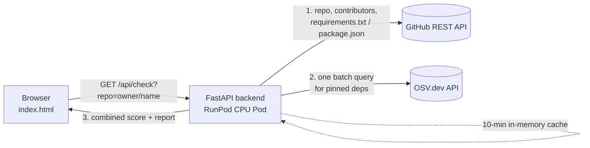

# GPU Pre-flight ✈️

**Check an open-source AI repo before you spin up a GPU for it.**

A common RunPod workflow is: find a repo like ComfyUI or a text-generation UI, clone it onto a GPU pod, `pip install -r requirements.txt`, and run it. Before paying for GPU time and running someone else's code, you probably want quick answers to:

| Question | Answered by |
|---|---|
| Is anyone still maintaining this? What happens if one person disappears? | **GitHub REST API**: bus factor, contributors, last push, archived status |
| Am I allowed to use it for my project? | **GitHub REST API**: license |
| Will `pip install` give me what the authors tested? | **GitHub REST API**: share of dependencies that are pinned |
| Does it install packages with known vulnerabilities? | **OSV.dev API**: advisories for each pinned dependency |

Neither API answers the question alone. The backend joins them: it reads the dependency manifest **from GitHub**, then sends those packages **to OSV** in one batch call, and combines everything into a single score.

- **Live app:** https://crel0fa1ys0gu3-8000.proxy.runpod.net
- **Failure demo:** https://crel0fa1ys0gu3-8000.proxy.runpod.net/?simulate=osv_down
- **Health check:** https://crel0fa1ys0gu3-8000.proxy.runpod.net/health

## Architecture



The frontend is a single static page served by the same FastAPI app, so there's one deploy and one URL. The GitHub token lives only in the Pod's environment variables and never reaches the browser.

## Request walkthrough

1. **Validate** (`service.parse_repo`): only `owner/name` or a `github.com` URL is accepted. Anything else returns `400` before any upstream call.
2. **Cache check**: a repeat check within 10 minutes is served from memory, saving GitHub quota.
3. **GitHub (required)**: repo metadata, top 100 contributors, and the first manifest found at the repo root.
4. **Parse**: count all dependencies, then keep only pinned ones (`pkg==1.2.3`, or npm `^1.2.3` → `1.2.3`), capped at 50. OSV needs a concrete version for a meaningful answer, and the pinned share is itself a reproducibility signal.
5. **OSV (optional)**: one `POST /v1/querybatch` for all packages.
6. **Score**: start at 100, subtract for bus factor ≤ 2, for advisories, and for stale pushes. Archived repos are flagged outright.

## Failure handling

| Situation | What the user sees | HTTP |
|---|---|---|
| Invalid input | "Enter a GitHub repo as owner/name…" | 400 |
| Repo missing or private | "Repository not found" | 404 |
| GitHub rate limit hit | Error with "try again in ~N min" (from `Retry-After` / `X-RateLimit-Reset`) | 429 |
| GitHub timeout / 5xx | Retried once, then a clear error | 504 / 502 |
| **OSV down** | **Report still shown** with a warning banner; vulnerabilities marked "not checked" | 200 |
| Repo renamed or moved | Redirect followed automatically; report shows the repo's new name | 200 |

GitHub is the source of truth for the workflow, so its failures fail the request. OSV failures **degrade gracefully**, because maintainer data is still useful on its own. A report built while OSV was down is not cached, so it isn't served after OSV recovers.

### Try a failure live

When the server runs with `DEMO_MODE=1`, adding `?simulate=osv_down` to the page URL swaps in an OSV client that always fails: https://crel0fa1ys0gu3-8000.proxy.runpod.net/?simulate=osv_down

Without `DEMO_MODE=1` the flag is ignored, so it can't be used to break a normal deployment.

### Tracing a request

Every upstream call is logged with its status and timing. On the pod, run `tail -f server.log`. Example output (timings vary):

```
INFO    check   repo='AUTOMATIC1111/stable-diffusion-webui'
INFO    GitHub  GET /repos/AUTOMATIC1111/stable-diffusion-webui -> 200 (180ms)
INFO    GitHub  GET /repos/AUTOMATIC1111/stable-diffusion-webui/contributors -> 200 (240ms)
INFO    GitHub  GET /repos/AUTOMATIC1111/stable-diffusion-webui/contents/requirements.txt -> 200 (130ms)
INFO    OSV.dev POST /v1/querybatch -> 200 (310ms)
```

## Environment variables

| Variable | Required | What it does |
|---|---|---|
| `GITHUB_TOKEN` | Recommended | Raises GitHub's limit from 60 to 5,000 requests/hour. Fine-grained token, public repositories, read-only. Kept server-side only. |
| `DEMO_MODE` | No | Set to `1` to enable the `?simulate=osv_down` failure drill. |

`.env` is in `.gitignore`; `.env.example` shows the format.

## Free-tier limits

| API | Key needed | Limit | How the app copes |
|---|---|---|---|
| GitHub REST | Optional `GITHUB_TOKEN` | 60 req/hr without a token, 5,000 req/hr with one | ≤ 4 calls per check, 10-min cache, rate limit surfaced to the user with a wait time |
| OSV.dev | None | No published quota | One batch request per check instead of one per package |

## Run locally

Requires Python 3.10 or newer.

```bash
python3 -m venv .venv && source .venv/bin/activate
pip install -r requirements-dev.txt
export GITHUB_TOKEN=<your token>
DEMO_MODE=1 uvicorn app.main:app --reload --port 8000
```

Open http://localhost:8000. The token is optional locally.

## Tests

```bash
pytest -q
```

Both external APIs are mocked with `respx`, so tests are fast and need no network. They cover:

- the full happy path combining both APIs
- manifest parsing: pinned vs unpinned, comments, `-r` includes and git URLs
- archived repos
- **OSV returning 503** → report still returned, security marked unavailable
- **GitHub rate limit** → 429 with `Retry-After`
- repo not found
- **renamed repos**: GitHub's 301 redirect is followed
- the failure drill only works when `DEMO_MODE=1`
- invalid input, including path-traversal attempts, makes **zero** upstream calls

## Deploy to RunPod (Pod)

This app runs on a **CPU Pod** (2 vCPU, 8 GB RAM, about $0.08/hr). It only calls APIs, so a GPU would add cost and nothing else.

1. In the RunPod console, go to **Pods → Deploy**, choose the **CPU** tab and the 2 vCPU option, and pick a RunPod Ubuntu template.
2. Click **Set overrides**:
   - Expose HTTP ports: `8000`
   - Environment variables: `GITHUB_TOKEN` = your token, `DEMO_MODE` = `1`
3. Deploy. When the pod is running, open **Connect → Web Terminal** and run:
   ```bash
   git clone https://github.com/anabellewatt/gpu-preflight.git && cd gpu-preflight
   PY=$(command -v python3.12 || command -v python3.11 || command -v python3.10 || command -v python3)
   $PY --version
   $PY -m pip install -r requirements.txt
   nohup $PY -m uvicorn app.main:app --host 0.0.0.0 --port 8000 > server.log 2>&1 &
   tail -f server.log
   ```
   The version check matters: older Ubuntu images default to Python 3.8, and this app needs 3.10+. The `PY=` line picks the newest Python on the image.
4. Open **Connect → HTTP Service [Port 8000]**, which goes to `https://<POD_ID>-8000.proxy.runpod.net`. Check that `/health` returns `{"ok": true}`.

If the pod restarts, the URL stays the same, but the server must be started again: rerun the `cd`, `PY=` and `nohup` lines.

**Alternative:** build the included `Dockerfile`, push it to Docker Hub, and use the image in a custom RunPod Pod template with port 8000 exposed. This makes the deploy reproducible with no manual steps.

## Project layout

```
app/
  clients.py   # GitHub + OSV clients, retries, rate-limit detection, manifest parsing
  service.py   # the workflow: validate → cache → GitHub → OSV → score
  main.py      # FastAPI routes and error → HTTP mapping
  static/index.html  # the whole frontend: loading, error, partial and success states
tests/test_api.py
```

## Technical challenge: renamed repos

Popular AI repos move between owners as they grow. ComfyUI and text-generation-webui both answered my first version with `301 Moved Permanently`, and the app treated that as an error, even though both repos are fine. `httpx` doesn't follow redirects by default. The fix was `httpx.AsyncClient(follow_redirects=True)` plus a regression test (`test_follows_renamed_repo_redirect`). The report now shows the repo's current name.

## What I'd improve with more time

- Parse `pyproject.toml` and lockfiles (`poetry.lock`, `uv.lock`) so unpinned and modern-packaged deps get checked too; many AI repos have moved there
- GPU-specific checks: flag pinned CUDA / `torch` versions and compare them with the CUDA versions available on RunPod base images
- A "Deploy to RunPod" button that pre-fills a Pod template for repos that pass
- Page through contributors for very large repos (currently top 100)
- Replace the in-memory cache with Redis so it survives restarts and scales across Pods
- Show OSV severity scores, not just advisory counts
- Run the GitHub calls concurrently
- Deploy from the included `Dockerfile` as a custom RunPod template, so the pod starts the app on boot with no manual steps

## AI usage

Built with help from Claude for scaffolding the code, tests and README. I reviewed every file, ran the tests, and deployed it myself. 
